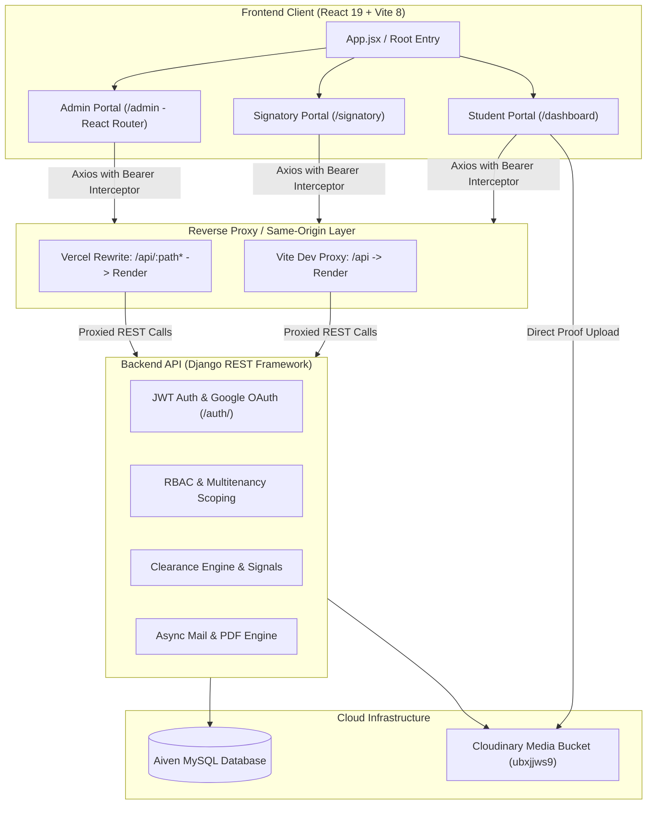
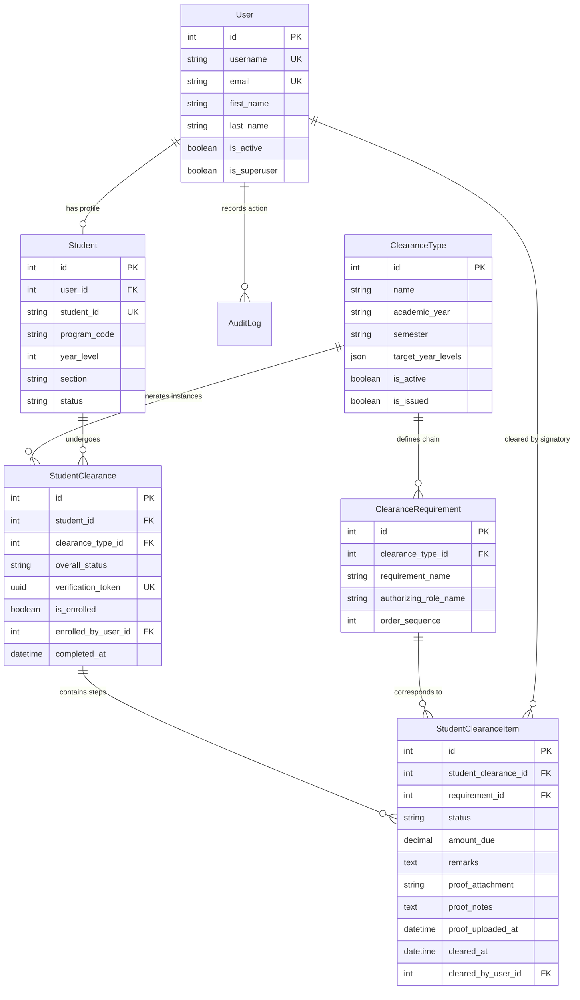
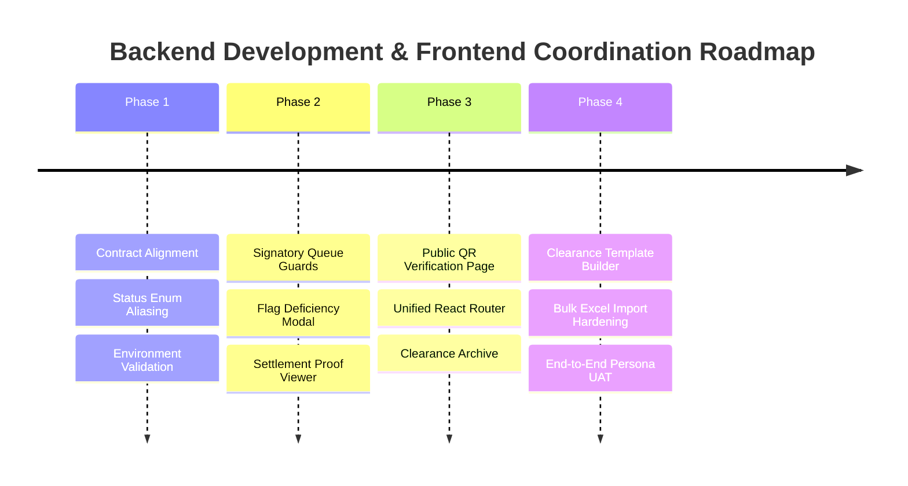

# E-Clearance DNSC: Senior Engineering Assessment & Backend Integration Blueprint

**Document Version:** 1.0  
**Role:** Senior Software Engineer & Backend Mentor  
**Target Audience:** Backend Developers, Frontend Team, and Project Leads  
**Repository Working Copy:** `C:\Python\E_Clearance_Dnsc`  

---

## 1. Executive Summary & Architecture Overview

The **ClearanceDNSC** platform digitizes and automates institutional academic clearance for Davao del Norte State College (DNSC). It transitions physical multi-office paper clearance routing into an automated digital workflow with sequential approvals, financial deficiency tracking, proof-of-settlement uploads, cryptographic verification, and official PDF certificate issuance.

### Architecture Breakdown

### Technology Stack Summary

| Layer | Technologies & Libraries | Version / Details |
| :--- | :--- | :--- |
| **Frontend Framework** | React, React DOM | `^19.3.1` |
| **Build & Tooling** | Vite, `@vitejs/plugin-react` | `^8.3.6`, `^6.1.2` |
| **HTTP Client** | Axios | `^1.21.1` (with in-memory GET cache and 401 refresh queue) |
| **Routing** | `react-router-dom` | `^6.30.6` (used inside `/admin` sub-tree) |
| **Authentication** | `@react-oauth/google` | `^0.13.5` (Google Identity Services) |
| **UI Components** | `lucide-react` | `^1.73.0` + custom SVGs |
| **Backend Target** | Django REST Framework (DRF) | Hosted on Render (`e-clearance-system-api.onrender.com`) |
| **Database** | MySQL | Hosted on Aiven Cloud |
| **Media Storage** | Cloudinary CDN | Bucket `ubxjjws9` for avatars and payment receipts |

---

## 2. Progress Assessment: Actual Code vs. Documentation

A rigorous audit of the code was conducted, comparing active implementation files against `docs/schema.yaml`, `docs/FRONTEND_INTEGRATION_GUIDE.md`, and `docs/UI_UX_FRONTEND_BLUEPRINT.md`.

### 2.1 Feature Completion Matrix

| User Role / Portal | Feature / Screen | Implementation Status | Code Evidence & Technical Notes |
| :--- | :--- | :---: | :--- |
| **Public / Auth** | Username & Password Login | **Completed** | Full validation and JWT storage in [App.jsx](file:///C:/Python/E_Clearance_Dnsc/src/App.jsx). |
| **Public / Auth** | Google OAuth Login | **Completed** | `POST /api/v1/auth/google/` credential exchange in [App.jsx](file:///C:/Python/E_Clearance_Dnsc/src/App.jsx). |
| **Public / Auth** | 3-Step Password Reset | **Completed** | Request OTP -> Verify OTP -> Set Password in [passwordReset.js](file:///C:/Python/E_Clearance_Dnsc/src/services/passwordReset.js). |
| **Public / Auth** | Public QR Verification Screen (`S-3`) | **Missing** | No `/verify/:token` route exists. QR code points directly to raw backend JSON. |
| **Student** | Active Clearance Term & Status Header | **Completed** | [HeroBanner.jsx](file:///C:/Python/E_Clearance_Dnsc/src/components/HeroBanner.jsx) & [OverviewCards.jsx](file:///C:/Python/E_Clearance_Dnsc/src/components/OverviewCards.jsx). |
| **Student** | 6-Step Requirement Checklist | **Completed** | Paginated fetching of items in [StudentDashboard.jsx](file:///C:/Python/E_Clearance_Dnsc/src/pages/StudentDashboard.jsx). |
| **Student** | Deficiency Display (Fee & Remarks) | **Completed** | Displays callout box with outstanding balance and reason. |
| **Student** | Settlement Proof Upload | **Completed** | Multipart upload to `/upload-proof/` in [ClearanceRequest.jsx](file:///C:/Python/E_Clearance_Dnsc/src/components/ClearanceRequest.jsx). |
| **Student** | Download Clearance Certificate (PDF) | **Completed** | Binary blob streaming from `/certificate/` in [DownloadClearance.jsx](file:///C:/Python/E_Clearance_Dnsc/src/components/DownloadClearance.jsx). |
| **Student** | Clearance History Archive | **Missing** | Blueprint specified past term archive; only single active clearance rendered. |
| **Signatory** | Metrics Dashboard (`SIG-1`) | **Completed** | Wired to `student-clearance-items/signatory-dashboard/` in [SIG1.jsx](file:///C:/Python/E_Clearance_Dnsc/src/signatory/SIG1.jsx). |
| **Signatory** | Clearance Approval Queue (`SIG-2`) | **Partially Implemented** | Table renders and approves via `PATCH`, but **lacks sequential lock** (`canSignRequirement`). |
| **Signatory** | Flag Deficiency Dialog (`SIG-3`) | **Partially Implemented** | Button immediately flags item without prompting for `remarks` and `amount_due`. |
| **Signatory** | Settlement Proof Inspection (`SIG-4`) | **Partially Implemented** | Clicking "Inspect Proof" clears item immediately without receipt preview or reject button. |
| **Signatory (Chair)**| Cohort Analytics Dashboard (`SIG-5`) | **Completed** | Department metrics and completion gauges in [SIG-5.jsx](file:///C:/Python/E_Clearance_Dnsc/src/signatory/SIG-5.jsx). |
| **Signatory (Chair)**| Validate Term Enrollment (`SIG-5`) | **Completed** | Calls `POST /student-clearances/{id}/enroll/` for cleared students. |
| **Admin** | Executive Analytics Dashboard (`A-1`) | **Completed** | Wired to `/clearance-types/admin-summary/` in [ExecutiveDashboard.jsx](file:///C:/Python/E_Clearance_Dnsc/src/admin/pages/ExecutiveDashboard.jsx). |
| **Admin** | Clearance Template View & Issue (`A-2`)| **Partially Implemented** | Can edit and batch issue existing templates; **lacks Create Template modal**. |
| **Admin** | Student Directory & Bulk Excel Import | **Completed** | Searchable table and Excel dropzone in [StudentDirectory.jsx](file:///C:/Python/E_Clearance_Dnsc/src/admin/pages/StudentDirectory.jsx). |
| **Admin** | Signatory Roles & Staff Assignment | **Completed** | Wired to `/access/roles/` and `/access/assign/` in [SignatoryRoles.jsx](file:///C:/Python/E_Clearance_Dnsc/src/admin/pages/SignatoryRoles.jsx). |
| **Admin** | Audit Logs & Export (PDF/Excel) | **Completed** | Stream downloads from `/audit-logs/report/` in [AuditLogs.jsx](file:///C:/Python/E_Clearance_Dnsc/src/admin/pages/AuditLogs.jsx). |
| **Admin** | System Settings & Feature Toggles | **Completed** | Dynamic toggle updates via `portalApi.js` in [Settings.jsx](file:///C:/Python/E_Clearance_Dnsc/src/admin/pages/Settings.jsx). |

---

## 3. Backend Requirements & Domain Modeling

As the backend developer, the following domain model, endpoint contracts, and invariant rules govern the system.

### 3.1 Entity-Relationship Model

### 3.2 Core Backend Invariants & Business Logic

1. **Sequential Sign-off Validation (`validate_sequential_clearance`):**
   - When a signatory attempts to clear Step $N$ (`PATCH /student-clearance-items/{id}/` with `status: "cleared"`), the backend must query steps $1 \dots N-1$ for that clearance.
   - If any prior step is not in the `cleared` state, the request must fail with `HTTP 400 Bad Request` (`Sequential clearance order violation`).
2. **Atomic Status Cascading:**
   - **Deficiency Transition:** If any item is marked `has_issue`, the parent `StudentClearance.overall_status` automatically transitions to `has_issue`.
   - **Completion Transition:** When Step 6 (final step) is marked `cleared`, the backend post-save signal must atomically:
     - Mark `StudentClearance.overall_status = "completed"`.
     - Timestamp `completed_at = timezone.now()`.
     - Mint a secure UUIDv4 `verification_token`.
     - Trigger Celery asynchronous email notification containing the digital certificate attachment.
3. **Multitenancy & Institute Scoping:**
   - The platform enforces institutional scoping (`Institute of Computing`). Signatories, chairs, and administrators must only access student records whose enrolled program belongs to their institute.
4. **Cloudinary Asset Management:**
   - Proof uploads (`POST /student-clearance-items/{id}/upload-proof/`) and profile avatars (`PATCH /me/update/`) validate MIME types (JPEG, PNG, PDF) and enforce a 5MB size limit before streaming to Cloudinary bucket `ubxjjws9`. The HTTPS CDN URL is stored in the database.

---

## 4. Key Architectural Inconsistencies & Technical Debt

### 1. Status Enum Mismatch (Backend vs. Frontend Contract)
* **Backend Database (`schema.yaml`):**
  - Item status: `pending`, `cleared`, `has_issue`.
  - Overall status: `pending`, `in_progress`, `completed`, `rejected`.
* **Frontend UI & Blueprints:** Heavily use `deficiency` and `under_review`.
* **Current Fragile Workaround:** [signatoryApi.js](file:///C:/Python/E_Clearance_Dnsc/src/signatory/signatoryApi.js#L361-L363) maps `Deficiency` -> `has_issue`, and [StudentDashboard.jsx](file:///C:/Python/E_Clearance_Dnsc/src/pages/StudentDashboard.jsx#L121-L125) maps `has_issue` -> `deficiency`.
* **Backend Solution:** Update DRF serializer choices to accept `deficiency` as an alias for `has_issue`, and formalize `under_review` as a first-class status.

### 2. QR Code URL Encoding Mismatch
* In [DownloadClearance.jsx](file:///C:/Python/E_Clearance_Dnsc/src/components/DownloadClearance.jsx#L335-L340), the QR code encodes:
  `https://e-clearance-system-api.onrender.com/api/v1/student-clearances/verify/{token}/`
* When scanned with a mobile phone camera, this renders raw JSON in the browser.
* **Solution:** The QR code must encode `https://<frontend-host>/verify/{token}`, which renders the branded Public Verification screen (`S-3`) and fetches the verification payload behind the scenes.

### 3. Client-Side Routing Fragmentation
* `App.jsx` handles `/login`, `/dashboard`, `/signatory`, `/admin` using manual string matching on `window.location.pathname`.
* `AdminPortal.jsx` uses `react-router-dom` `<BrowserRouter basename="/admin">`.
* `StudentDashboard.jsx` and `SignatoryApp.jsx` use local `useState` tabs.
* **Impact:** Documented URLs such as `/student/clearance` or `/signatory/queue` fall through to the public landing page.

### 4. Dead Code & Outdated Documentation
* `src/admin/data/mockData.js`: 124 lines of unreferenced mock data.
* `src/admin/pages/StubPage.css`: Completely unreferenced CSS file.
* `README.md`: Contained outdated statements claiming admin screens used sample data. (Updated during this review).

---

## 5. Development Roadmap & Prioritization

### Phase 1: Contract Alignment & Environment Readiness (Immediate)
* **Backend:**
  - Update DRF `StudentClearanceItem` serializer to accept both `has_issue` and `deficiency` without validation errors.
  - Add `under_review` to `StudentClearanceItemStatusEnum`.
* **Frontend:**
  - Run `npm install` in the workspace to restore `node_modules`.
  - Verify proxy connectivity against `https://e-clearance-system-api.onrender.com`.

### Phase 2: Signatory Queue & Proof Settlement Completion
* **Frontend:**
  - In [SIG2.jsx](file:///C:/Python/E_Clearance_Dnsc/src/signatory/SIG2.jsx), implement `canSignRequirement()` to disable the Approve button if prior steps are unapproved.
  - In [SIG2.jsx](file:///C:/Python/E_Clearance_Dnsc/src/signatory/SIG2.jsx), wire the Flag button to open Modal `SIG-3` to collect `remarks` and `amount_due`.
  - In [SIG3.jsx](file:///C:/Python/E_Clearance_Dnsc/src/signatory/SIG3.jsx), implement Modal `SIG-4` (Proof Document Viewer) with Cloudinary image preview and Reject Proof action.
* **Backend:**
  - Ensure reject proof action properly dispatches deficiency notification and resets proof state.

### Phase 3: Public QR Verification & Navigation Consolidation
* **Frontend:**
  - Build the missing Public QR Verification page (`Screen S-3`) at route `/verify/:token`.
  - Update [DownloadClearance.jsx](file:///C:/Python/E_Clearance_Dnsc/src/components/DownloadClearance.jsx) so the generated QR code points to the `/verify/:token` web route.
  - Migrate top-level routing in `App.jsx` to `react-router-dom`.

### Phase 4: Admin Portal Finalization & Full-Stack UAT
* **Frontend:**
  - In [ClearanceTemplates.jsx](file:///C:/Python/E_Clearance_Dnsc/src/admin/pages/ClearanceTemplates.jsx), add the "Create Clearance Template" modal.
* **Full-stack:**
  - Validate bulk Excel student onboarding (`POST /admin/student-bulk-invitations/upload/`).
  - Perform full end-to-end UAT across Student, Signatory, Program Chair, and Admin personas using seeded test accounts (`Student202400633`).
