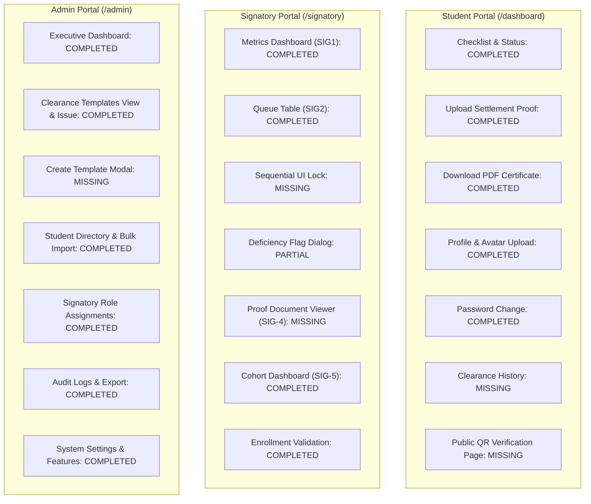
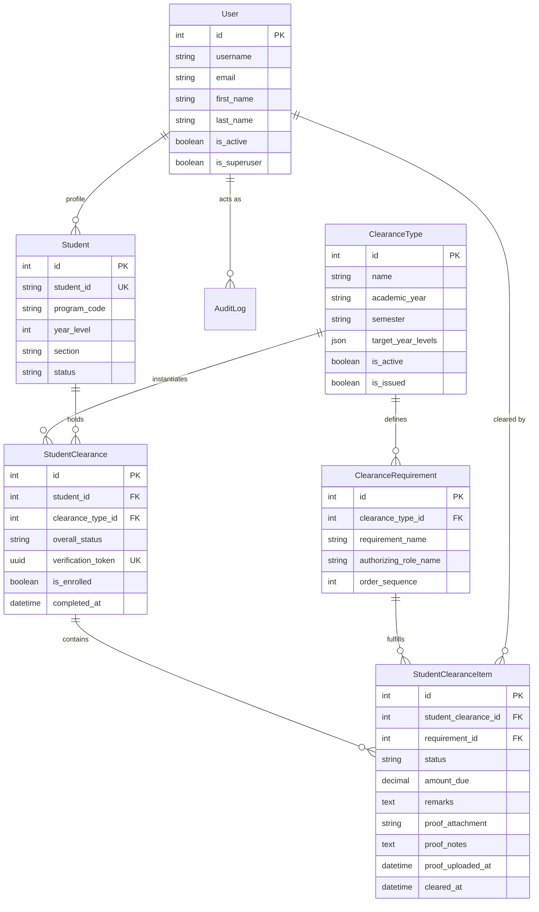
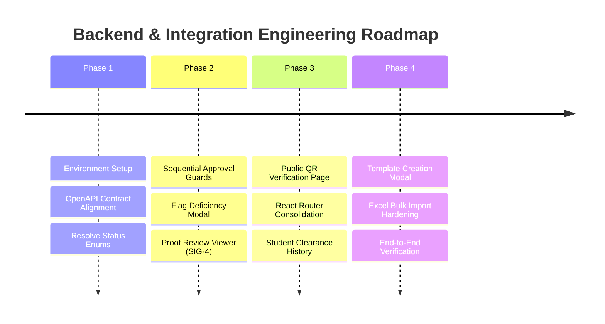

# E-Clearance DNSC: Architectural Assessment & Backend Integration Roadmap

**Document Version:** 1.0  
**Prepared By:** Senior Software Engineer & Backend Mentor  
**Target Audience:** Frontend Team, Backend Developers, and Technical Leads  
**Repository Working Copy:** `C:\Python\E_Clearance_Dnsc`  

---

## Executive Summary

The **ClearanceDNSC** platform is a digitized academic clearance system for Davao del Norte State College (DNSC). Its primary objective is to replace traditional paper clearance slips with an automated, sequential digital clearance workflow featuring role-based approvals, deficiency settlement with photo receipts, digital PDF certificates, and cryptographic QR code verification.

The repository currently contains a React 19 single-page application (SPA) scaffolded with Vite 8. Significant work has been completed across all three primary user portals (Student, Clearance Signatory, and Administration). In addition, comprehensive documentation (`docs/`) has been assembled, including an OpenAPI 3.0.3 specification (`docs/schema.yaml`) and system blueprints.

This assessment provides an in-depth technical analysis of the existing codebase, documents the exact state of progress, identifies integration gaps and architectural inconsistencies, defines backend requirements, and outlines an actionable engineering roadmap.

---

## 1. Evaluation of the Current Workspace

### 1.1 Directory Structure & Architecture

```text
.
├── docs/
│   ├── api-types.ts                   # Generated TypeScript types (255 KB)
│   ├── FRONTEND_INTEGRATION_GUIDE.md  # Production API endpoints, payloads, auth & accounts
│   ├── schema.yaml                    # Full OpenAPI 3.0.3 spec (9,041 lines, 78 endpoints)
│   ├── UI_UX_DESIGN_GUIDE.md          # UI/UX specifications & interface requirements
│   └── UI_UX_FRONTEND_BLUEPRINT.md    # System architecture, sequence diagrams & Figma specs
├── public/
│   ├── dnsc-logo.jpg
│   └── favicon.svg
├── src/
│   ├── admin/                         # Admin portal sub-application
│   │   ├── components/                # Navbar, SidebarPanel
│   │   ├── data/                      # mockData.js (Dead/unreferenced stub data)
│   │   ├── pages/                     # ExecutiveDashboard, ClearanceTemplates, StudentDirectory,
│   │   │                              # SignatoryRoles, AuditLogs, Profile, Settings
│   │   └── services/                  # portalApi.js, dashboardApi.js
│   ├── assets/                        # SVG icons, illustrations, university seal
│   ├── components/                    # Student dashboard components (ClearanceRequest,
│   │                                  # ClearanceTracker, DownloadClearance, ProfileSection, etc.)
│   ├── pages/                         # StudentDashboard.jsx
│   ├── services/                      # Core services (api.js, auth.js, account.js,
│   │                                  # notifications.js, passwordReset.js, clearanceDisplay.js)
│   ├── signatory/                     # Clearance officer portal
│   │   ├── SIG1.jsx                   # Signatory Overview Dashboard
│   │   ├── SIG2.jsx                   # Clearance Approval Queue Table
│   │   ├── SIG3.jsx                   # Deficiencies & Proofs Kanban
│   │   ├── SIG-5.jsx                  # Program Chair Cohort Overview & Enrollment Validation
│   │   ├── SignatoryApp.jsx           # Signatory state container & notification manager
│   │   ├── SignatoryLayout.jsx        # Navigation shell & notification flyout
│   │   └── signatoryApi.js            # Signatory API client & data mappers
│   ├── styles/                        # dashboard.css, navigation.css, theme.css
│   ├── AdminPortal.jsx                # Admin route container (BrowserRouter basename="/admin")
│   ├── App.jsx                        # Root container (Home, Login, Password Reset, Routing)
│   ├── main.jsx                       # React 19 entry point
│   └── index.css
├── .env.example                       # VITE_API_BASE_URL, VITE_GOOGLE_CLIENT_ID
├── eslint.config.js
├── index.html
├── package.json                       # Dependencies & scripts
├── README.md                          # Project documentation
├── vercel.json                        # Deployment rewrites (/api proxy)
└── vite.config.js                     # Vite dev proxy configuration
```

### 1.2 Technology Stack

| Layer | Technologies & Libraries | Version / Details |
| :--- | :--- | :--- |
| **Framework & Core** | React, React DOM | `^19.3.1` |
| **Build Tooling** | Vite, `@vitejs/plugin-react` | `^8.3.6`, `^6.1.2` |
| **Routing** | `react-router-dom` | `^6.30.6` (Used inside Admin Portal only) |
| **HTTP Client** | Axios | `^1.21.1` (With JWT Bearer & refresh interceptors) |
| **Authentication** | `@react-oauth/google` | `^0.13.5` (Google Identity Services) |
| **Icons & UI** | `lucide-react` | `^1.73.0` + custom SVGs |
| **Linting** | ESLint | `^10.14.0` |
| **Backend Target** | Django REST Framework (DRF) | Python backend hosted on Render, MySQL on Aiven |
| **Cloud Storage** | Cloudinary CDN | Asset bucket `ubxjjws9` for avatar & proof images |

### 1.3 Key Architectural Patterns
* **Token Management & Interceptors ([src/services/api.js](file:///C:/Python/E_Clearance_Dnsc/src/services/api.js)):** Axios attaches `Authorization: Bearer <auth_token>` to outgoing requests (excluding public password-reset calls). When encountering a `401 Unauthorized`, a response interceptor automatically handles queueing and sends a refresh request to `/token/refresh/` using `auth_refresh_token`.
* **API Proxying:** In development, Vite proxies `/api` to `https://e-clearance-system-api.onrender.com`. In production on Vercel, `vercel.json` rewrites `/api/:path*` to the same host, avoiding browser Cross-Origin Resource Sharing (CORS) complications.
* **Role-Based Dynamic Mounting:** [App.jsx](file:///C:/Python/E_Clearance_Dnsc/src/App.jsx) queries `GET /api/v1/me/` on initialization, resolves user groups via [account.js](file:///C:/Python/E_Clearance_Dnsc/src/services/account.js), and conditionally lazy-loads either the Student, Signatory, or Admin portal.

---

## 2. Project Progress Assessment

Based on actual source code inspection rather than documentation claims:

### 2.1 Feature Status Breakdown



### 2.2 Detailed Status Matrix

| Component / Feature | Screen / File | Implementation State | Findings & Actual Evidence |
| :--- | :--- | :--- | :--- |
| **Login (Username/Password)** | `LoginPage` in `App.jsx` | **Completed** | Full validation, field error parsing, token storage, and redirection. |
| **Google Sign-In** | `LoginPage` in `App.jsx` | **Completed** | Google OAuth button renders, exchanges ID token via `POST /auth/google/`. |
| **Password Recovery Flow** | `ForgotPasswordPage` in `App.jsx` | **Completed** | 3-step OTP flow (`/password-reset/request/`, `/verify/`, `/change/`). |
| **Student Clearance Checklist** | [StudentDashboard.jsx](file:///C:/Python/E_Clearance_Dnsc/src/pages/StudentDashboard.jsx) | **Completed** | Calls `/student-clearances/my-clearances/`, handles pagination across `/student-clearance-items/`. |
| **Settlement Proof Upload** | [ClearanceRequest.jsx](file:///C:/Python/E_Clearance_Dnsc/src/components/ClearanceRequest.jsx) | **Completed** | Uploads multipart file + notes to `/upload-proof/`, validates 5MB limit. |
| **Certificate PDF Download** | [DownloadClearance.jsx](file:///C:/Python/E_Clearance_Dnsc/src/components/DownloadClearance.jsx) | **Completed** | Streams binary blob from `/certificate/` and triggers browser file save. |
| **Public QR Verification UI** | None (`Screen S-3`) | **Missing** | No `/verify/:token` route exists in `App.jsx`. QR link opens raw JSON from API. |
| **Clearance History Archive** | [StudentDashboard.jsx](file:///C:/Python/E_Clearance_Dnsc/src/pages/StudentDashboard.jsx) | **Missing** | Blueprint specified past term archive, but only single active clearance is shown. |
| **Signatory Metrics Dashboard** | [SIG1.jsx](file:///C:/Python/E_Clearance_Dnsc/src/signatory/SIG1.jsx) | **Completed** | Fetches `/signatory-dashboard/`, renders pending, deficiency, cleared counters. |
| **Signatory Approval Queue** | [SIG2.jsx](file:///C:/Python/E_Clearance_Dnsc/src/signatory/SIG2.jsx) | **Partially Implemented** | Table renders and approves via `PATCH`, but **lacks sequential approval guard** (`canSignRequirement`). |
| **Flag Deficiency Dialog** | [SIG2.jsx](file:///C:/Python/E_Clearance_Dnsc/src/signatory/SIG2.jsx) | **Partially Implemented** | Clicking "Flag" immediately marks item `has_issue` without opening a modal for remarks or amount due. |
| **Proof Inspection Dialog (`SIG-4`)** | [SIG3.jsx](file:///C:/Python/E_Clearance_Dnsc/src/signatory/SIG3.jsx) | **Partially Implemented** | Clicking "Inspect Proof" clears item immediately. **No receipt image preview** or Reject button. |
| **Program Chair Cohort Analytics** | [SIG-5.jsx](file:///C:/Python/E_Clearance_Dnsc/src/signatory/SIG-5.jsx) | **Completed** | Renders cohort completion rates, year-level breakdown, program stats. |
| **Enrollment Validation** | [SIG-5.jsx](file:///C:/Python/E_Clearance_Dnsc/src/signatory/SIG-5.jsx) | **Completed** | Calls `POST /student-clearances/{id}/enroll/` for cleared students. |
| **Executive Admin Analytics** | [ExecutiveDashboard.jsx](file:///C:/Python/E_Clearance_Dnsc/src/admin/pages/ExecutiveDashboard.jsx) | **Completed** | Wired to `/clearance-types/admin-summary/` and bottleneck analysis. |
| **Clearance Templates Management** | [ClearanceTemplates.jsx](file:///C:/Python/E_Clearance_Dnsc/src/admin/pages/ClearanceTemplates.jsx) | **Partially Implemented** | Wired to view/edit/issue existing templates, but **lacks Create Template modal**. |
| **Student Directory & Bulk Import** | [StudentDirectory.jsx](file:///C:/Python/E_Clearance_Dnsc/src/admin/pages/StudentDirectory.jsx) | **Completed** | Wired to `students/`, Excel upload to `/admin/student-bulk-invitations/upload/`. |
| **Signatory Role Assignment** | [SignatoryRoles.jsx](file:///C:/Python/E_Clearance_Dnsc/src/admin/pages/SignatoryRoles.jsx) | **Completed** | Wired to `/access/roles/` and `/access/assign/`. |
| **Audit Logs & Export** | [AuditLogs.jsx](file:///C:/Python/E_Clearance_Dnsc/src/admin/pages/AuditLogs.jsx) | **Completed** | Wired to `/audit-logs/`, exports PDF and Excel streams. |
| **System Settings & Toggles** | [Settings.jsx](file:///C:/Python/E_Clearance_Dnsc/src/admin/pages/Settings.jsx) | **Completed** | Wired to `/system-settings/` and bulk update endpoint. |

### 2.3 Issues, Inconsistencies & Dead Code

1. **Routing Inconsistency Across Portals:**
   - [App.jsx](file:///C:/Python/E_Clearance_Dnsc/src/App.jsx) uses manual `window.location.pathname` inspection and `popstate` listeners.
   - [AdminPortal.jsx](file:///C:/Python/E_Clearance_Dnsc/src/AdminPortal.jsx) uses `react-router-dom` `<BrowserRouter basename="/admin">`.
   - [StudentDashboard.jsx](file:///C:/Python/E_Clearance_Dnsc/src/pages/StudentDashboard.jsx) and [SignatoryApp.jsx](file:///C:/Python/E_Clearance_Dnsc/src/signatory/SignatoryApp.jsx) use local `useState` tabs (`currentTab`, `activePage`).
   - *Impact:* Documented URLs like `/student/clearance` or `/signatory/queue` fall through to the public landing page because `App.jsx` strictly checks `currentPath === '/dashboard'` or `currentPath === '/signatory'`.
2. **Status Enum Nomenclature Mismatch:**
   - **Backend DB Schema (`schema.yaml`):** Items have statuses: `pending`, `cleared`, `has_issue`. Clearance instances have: `pending`, `in_progress`, `completed`, `rejected`.
   - **Frontend UI & Blueprints:** Heavily use `deficiency` and `under_review`.
   - *Impact:* Fragile translation layers exist throughout the code (e.g. `normalizeRequirement` converts `has_issue` to `deficiency`, and `applySignatoryUpdate` maps `Deficiency` back to `has_issue`).
3. **Dead / Unreferenced Code:**
   - `src/admin/data/mockData.js`: 124 lines of sample data not imported anywhere in the project.
   - `src/admin/pages/StubPage.css`: Completely unreferenced stylesheet.
   - `README.md`: Contains outdated claims stating admin pages "still use sample data" and "are not wired to the E-Clearance API". In reality, they are already wired to `dashboardApi.js` and `portalApi.js`.

---

## 3. Backend Requirements & Architecture

### 3.1 Domain Model & Entity-Relationship Diagram



### 3.2 Critical Business Logic & Enforcement Rules

1. **Sequential Sign-off Validation (`validate_sequential_clearance`):**
   - The backend must strictly reject any attempt to clear Step $N$ if Step $N-1$ is not in the `cleared` state with an HTTP `400 Bad Request` (`Sequential clearance order violation`).
2. **Automated Overall Status Transitions:**
   - Transition to `has_issue`: If any single item transitions to `has_issue`, `StudentClearance.overall_status` automatically transitions to `has_issue` / `deficiency`.
   - Transition to `completed`: When the final sequential item is signed off, the backend must atomically:
     1. Mark `StudentClearance.overall_status = 'completed'`.
     2. Set `completed_at = timezone.now()`.
     3. Generate a secure cryptographic `verification_token` (UUID v4).
     4. Dispatch an asynchronous notification with the certificate PDF.
3. **Role-Based Authorization & Multitenancy Scoping:**
   - Signatory sign-off endpoints (`PATCH /student-clearance-items/{id}/`) must enforce that `request.user` belongs to the `authorizing_role_name` associated with that requirement.
   - Signatories must only access student records belonging to their institute (Institute of Computing).
4. **Cloudinary Integration:**
   - File uploads via `/student-clearance-items/{id}/upload-proof/` and `/me/update/` must validate MIME type (PDF, JPEG, PNG) and file size ($\le 5\text{MB}$), stream directly to Cloudinary, and save the permanent secure HTTPS URL to the model.

---

## 4. Practical Development Roadmap



### Phase 1: Environment Setup & Contract Alignment (Week 1)
* **Action 1.1:** Initialize Node environment in the frontend repository (`npm install`).
* **Action 1.2:** Resolve the status enum contract: Standardize between backend `has_issue` and frontend `deficiency`. Formalize `under_review` as either an item status or a computed frontend state.
* **Action 1.3:** Synchronize documentation: Update [README.md](file:///C:/Python/E_Clearance_Dnsc/README.md) to reflect that the admin portal is actively wired to live endpoints.

### Phase 2: Signatory Queue & Settlement Proof Enhancements (Week 2)
* **Action 2.1 (Frontend):** In [SIG2.jsx](file:///C:/Python/E_Clearance_Dnsc/src/signatory/SIG2.jsx), implement `canSignRequirement` to disable the "Approve" button if previous requirements are unapproved, preventing backend 400 errors.
* **Action 2.2 (Frontend):** In [SIG2.jsx](file:///C:/Python/E_Clearance_Dnsc/src/signatory/SIG2.jsx), replace the instant "Flag" action with the proper `Modal SIG-3` (Flag Deficiency Dialog) prompting for `remarks` and optional `amount_due`.
* **Action 2.3 (Frontend):** In [SIG3.jsx](file:///C:/Python/E_Clearance_Dnsc/src/signatory/SIG3.jsx), implement the full `Modal SIG-4` (Settlement Proof Review) with receipt image rendering from Cloudinary, student notes, and both "Approve Settlement" and "Reject Proof" controls.

### Phase 3: Public QR Verification & Routing Consolidation (Week 3)
* **Action 3.1 (Frontend):** Build the missing Public QR Verification page (`Screen S-3`) at `/verify/:token` utilizing `GET /student-clearances/verify/{verification_token}/`.
* **Action 3.2 (Frontend):** Consolidate routing under `react-router-dom` across the root app, deprecating manual `window.location.pathname` string matching in [App.jsx](file:///C:/Python/E_Clearance_Dnsc/src/App.jsx).
* **Action 3.3 (Frontend):** Add "Clearance History" view to the Student Portal to view archived clearances.

### Phase 4: Admin Portal Finalization & Verification (Week 4)
* **Action 4.1 (Frontend):** In [ClearanceTemplates.jsx](file:///C:/Python/E_Clearance_Dnsc/src/admin/pages/ClearanceTemplates.jsx), build the Create Template Modal to allow admins to define new templates and sequence steps.
* **Action 4.2 (Full-stack):** Test bulk Excel student onboarding (`POST /admin/student-bulk-invitations/upload/`) end-to-end.
* **Action 4.3 (Full-stack):** Conduct end-to-end user acceptance testing across Student, Signatory, and Admin personas using the seeded BSIT 3-C test accounts (`Student202400633`).
