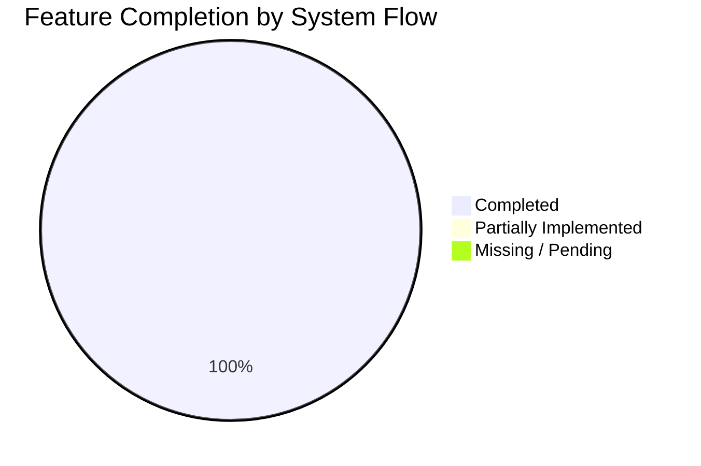

# E-Clearance DNSC: End-to-End System Progress & Business Logic Checklist

**Document Purpose:** Living tracking matrix and verification checklist for the E-Clearance platform. Categorized by end-to-end business logic and system workflows.  
**Target Roles:** Backend Developers, Frontend Developers, QA, Project Lead  
**Last Updated:** Integration Complete (Ready for Final UAT)

---

## Progress Overview

| Legend | Meaning |
| :---: | :--- |
| `[x]` | **Completed:** Verified in code and wired to active contracts. |
| `[-]` | **Partially Implemented:** Functional in part, but missing critical business rules, UI modals, or validations. |
| `[ ]` | **Missing / Not Implemented:** Specified in requirements/docs, but no active implementation exists. |

---

## 1. Authentication, Identity & Multi-Tenancy Flow

| Status | Layer | Business Logic / System Capability | Implementation & Evidence | Notes / Next Actions |
| :---: | :---: | :--- | :--- | :--- |
| `[x]` | **BE / FE** | Standard Credential Login (`POST /api/v1/login/`) | `LoginPage` in `src/App.jsx`, JWT storage in `localStorage`. | Handles field error mapping and redirects to account home. |
| `[x]` | **BE / FE** | Google OAuth Login (`POST /api/v1/auth/google/`) | `@react-oauth/google` in `src/App.jsx`, credential exchange. | Requires `VITE_GOOGLE_CLIENT_ID` in `.env.local`. |
| `[x]` | **BE / FE** | 3-Step Self-Service Password Reset (Email -> OTP -> New Password) | `ForgotPasswordPage` in `src/App.jsx`, `src/services/passwordReset.js`. | Wired to `/password-reset/request/`, `/verify/`, `/change/`. |
| `[x]` | **BE / FE** | Token Refresh Interceptor on 401s | `apiClient` in `src/services/api.js`. | Auto-refreshes access tokens via `POST /token/refresh/`. |
| `[x]` | **BE / FE** | Session Sign-out & Refresh Revocation | `signOut()` in `src/services/auth.js`. | Revokes refresh token via `POST /logout/` and clears storage. |
| `[x]` | **FE** | Route Redirection & Role-Based Routing | `accountKindFor()` in `src/services/account.js`, `App.jsx`, `AdminPortal.jsx`. | Supports `/dashboard`, `/student/*`, `/signatory/*`, `/admin/*`, `/password-reset`. |
| `[x]` | **BE / FE** | Self-Service Email Verification / Email Change | `EmailChangeCard.jsx`, `src/services/emailChange.js`. | Wired to `/email-change/*` across Student, Signatory, and Admin profiles. |

---

## 2. Phase 1: Clearance Setup & Issuance Flow (Admin)

| Status | Layer | Business Logic / System Capability | Implementation & Evidence | Notes / Next Actions |
| :---: | :---: | :--- | :--- | :--- |
| `[x]` | **BE / FE** | Executive Analytics Dashboard | `src/admin/pages/ExecutiveDashboard.jsx`. | Wired to `clearance-types/admin-summary/`, supports active/past cycle filtering. |
| `[x]` | **BE / FE** | View Active Clearance Templates & Sequence Steps | `src/admin/pages/ClearanceTemplates.jsx`. | Wired to `clearance-types/` and `clearance-types/{id}/dashboard/`. |
| `[x]` | **BE / FE** | Batch Issue Clearance to Target Students (`POST /issue/`) | `issueClearanceType()` in `src/admin/services/portalApi.js`. | Batch instantiates student clearance records campus-wide. |
| `[x]` | **FE** | Clearance Template Builder / Creation Modal | `src/admin/pages/ClearanceTemplates.jsx`. | Supports creating templates (`POST /clearance-types/`), cloning/adding/removing sequential steps. |
| `[x]` | **BE / FE** | Student Directory & Pagination | `src/admin/pages/StudentDirectory.jsx`. | Wired to `students/` with search, program, and year filters. |
| `[x]` | **BE / FE** | Bulk Student Import via Excel (`POST /student-bulk-invitations/upload/`) | `uploadStudentInvitations()` in `src/admin/services/portalApi.js`. | Supports file dropzone and sample Excel template download. |
| `[x]` | **BE / FE** | Signatory Role & Staff Delegation | `src/admin/pages/SignatoryRoles.jsx`. | Wired to `access/roles/` and `access/assign/`. |
| `[x]` | **BE / FE** | Audit Trail Log View & Report Export | `src/admin/pages/AuditLogs.jsx`. | Wired to `audit-logs/`, exports PDF and Excel streams. |
| `[x]` | **BE / FE** | Dynamic System Settings & Feature Toggles | `src/admin/pages/Settings.jsx`. | Wired to `system-settings/` and `system-settings/bulk-update/`. |

---

## 3. Phase 2: Student Clearance & Deficiency Settlement Flow (Student)

| Status | Layer | Business Logic / System Capability | Implementation & Evidence | Notes / Next Actions |
| :---: | :---: | :--- | :--- | :--- |
| `[x]` | **BE / FE** | Active Clearance Term & Progress Header | `HeroBanner.jsx`, `OverviewCards.jsx` in `src/components/`. | Displays term, overall status chip, progress bar ratio, and term switcher. |
| `[x]` | **BE / FE** | 6-Step Sequential Requirement Checklist | `StudentDashboard.jsx`, `MainContent.jsx`. | Fetches `student-clearances/my-clearances/` and paginates items. |
| `[x]` | **BE / FE** | Deficiency Display (Remarks & Amount Due) | `MainContent.jsx`, `RequirementsSection.jsx`. | Renders callout box when status is `deficiency` / `has_issue`. |
| `[x]` | **BE / FE** | Upload Settlement Proof File (`POST /upload-proof/`) | `ClearanceRequest.jsx` in `src/components/`. | Multipart form data with file validation ($\le 5\text{MB}$), notes, and Cloudinary upload. |
| `[x]` | **BE / FE** | Item Status Transition to "Under Review" | Backend `UNDER_REVIEW` + `StudentDashboard.jsx`. | Backend auto-moves items to `under_review` on proof upload/reply; UI renders native state. |
| `[x]` | **FE** | Cancel / Remove Uploaded Settlement Proof | `MainContent.jsx`, `ClearanceRequest.jsx`, `StudentDashboard.jsx`. | Wired to `DELETE /student-clearance-items/{id}/remove-proof/` with confirmation modal. |
| `[x]` | **BE / FE** | Student Profile & Avatar Upload | `ProfileSection.jsx` in `src/components/`. | Uploads avatar to Cloudinary via `PATCH /me/update/`. |
| `[x]` | **BE / FE** | In-App Password Change | `ProfileSection.jsx` in `src/components/`. | Wired to `POST /users/change-password/`. |
| `[x]` | **FE** | Student Clearance History Archive | `ClearanceHistory.jsx`, `StudentDashboard.jsx`. | Browse all active/past clearances with All/Active/Past filter and term switching. |

---

## 4. Phase 3: Signatory Review, Deficiency & Proof Approval Flow (Signatory)

| Status | Layer | Business Logic / System Capability | Implementation & Evidence | Notes / Next Actions |
| :---: | :---: | :--- | :--- | :--- |
| `[x]` | **BE / FE** | Signatory Workload Overview Dashboard | `SIG1.jsx` in `src/signatory/`. | Wired to `student-clearance-items/signatory-dashboard/` with active/past cycle filters. |
| `[x]` | **BE / FE** | Clearance Approval Queue Table | `SIG2.jsx` in `src/signatory/`. | Search, filter by program/status/cycle, paginates student records. |
| `[x]` | **FE** | Enforce Sequential Sign-off UI Lock | `SIG1.jsx`, `SIG2.jsx`, `SignatoryApp.jsx`, `signatoryApi.js`. | Disables Approve with prerequisite step tooltips and surfaces `blocked_by`/`detail` errors. |
| `[x]` | **FE** | Flag Deficiency Modal (`Modal SIG-3`) | `SIG2.jsx` in `src/signatory/`. | Prompts for required `remarks` and optional `amount_due` before saving. |
| `[x]` | **FE** | Settlement Proof Document Viewer & Reject (`Modal SIG-4`) | `ProofPreview.jsx`, `SIG2.jsx`, `SIG3.jsx`. | Displays receipt preview, notes, Approve Sign-Off, and Reject Proof with required reason. |
| `[x]` | **BE** | Asynchronous Deficiency Email Dispatch | Managed by backend Celery / mailer. | Sends email notice to student when an item is flagged. |
| `[x]` | **BE** | Multi-Tenant Institute Isolation | Scoped via DRF querysets and `request.user`. | Staff in Institute of Computing only see IC students. |

---

## 5. Phase 4: Program Chair Cohort & Term Enrollment Validation (Chair Extension)

| Status | Layer | Business Logic / System Capability | Implementation & Evidence | Notes / Next Actions |
| :---: | :---: | :--- | :--- | :--- |
| `[x]` | **BE / FE** | Program Chair Cohort Analytics Dashboard | `SIG-5.jsx` in `src/signatory/`. | Wired to `student-clearances/program-chair-dashboard/`. Displays completion gauge and year breakdown. |
| `[x]` | **BE / FE** | Role Guard for Cohort Tab | `SignatoryApp.jsx` & `SignatoryLayout.jsx`. | Accessible when role is Program Chair or admin. |
| `[x]` | **BE / FE** | Term Enrollment Validation Action (`POST /enroll/`) | `toggleValidate()` in `SIG-5.jsx`, `applySignatoryUpdate()` in `signatoryApi.js`. | Sets `is_enrolled = true` on `StudentClearance` for cleared students. |

---

## 6. Phase 5: Final Completion, Certification & Public QR Verification

| Status | Layer | Business Logic / System Capability | Implementation & Evidence | Notes / Next Actions |
| :---: | :---: | :--- | :--- | :--- |
| `[x]` | **BE** | Automatic Clearance Completion & Token Generation | Backend model signal / post-save hook. | Generates UUID `verification_token` when step 6 is cleared. |
| `[x]` | **BE / FE** | Download Digital Clearance Certificate PDF | `DownloadClearance.jsx` in `src/components/`. | Streams PDF blob from `student-clearances/{id}/certificate/`. |
| `[x]` | **BE / FE** | Public QR Code Verification Page (`Screen S-3`) | `DownloadClearance.jsx` + backend `/verify/<token>/`. | QR code and direct preview link point to backend dual-mode DNSC `verify.html`. |
| `[x]` | **BE** | Public Verification REST Endpoint | `GET /api/v1/student-clearances/verify/{token}/`. | Public endpoint returning authentication status, student details, and timestamp. |

---

## 7. Technical Debt & Codebase Hygiene Checklist

| Status | Category | Item | Recommended Action |
| :---: | :---: | :--- | :--- |
| `[x]` | **Cleanup** | `src/admin/data/mockData.js` | Deleted unreferenced stub file. |
| `[x]` | **Cleanup** | `src/admin/pages/StubPage.css` | Deleted unreferenced stylesheet. |
| `[x]` | **Docs** | `README.md` | Updated outdated text regarding admin portal wiring. |
| `[x]` | **Architecture** | App-wide Routing | Unified documented route aliases across `App.jsx`, `AdminPortal.jsx`, `StudentDashboard.jsx`, and `SignatoryApp.jsx`. |
| `[x]` | **API Contract** | Status Nomenclature | Aligned `has_issue` / `deficiency` alias and `under_review` enum across backend and frontend. |
